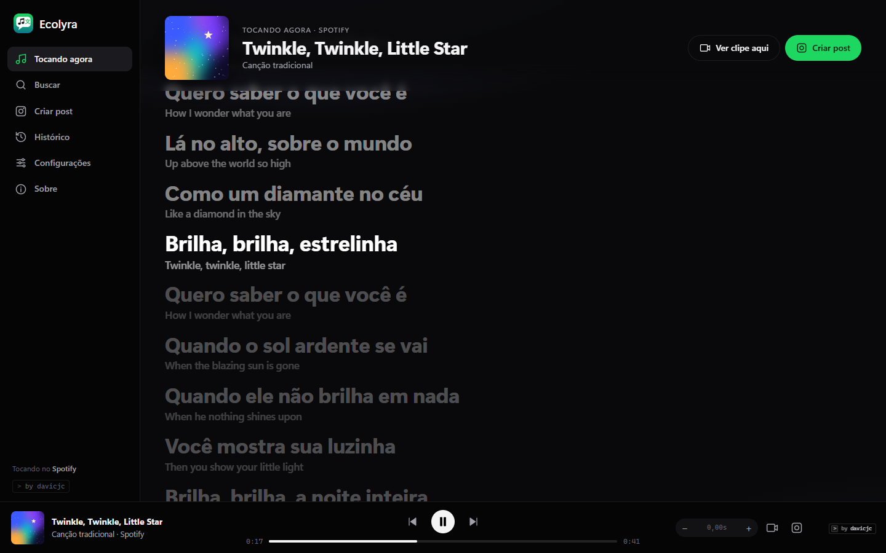
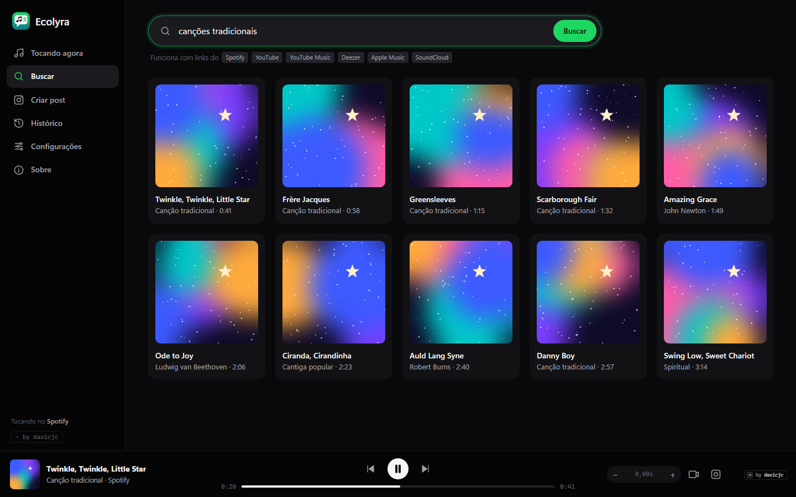
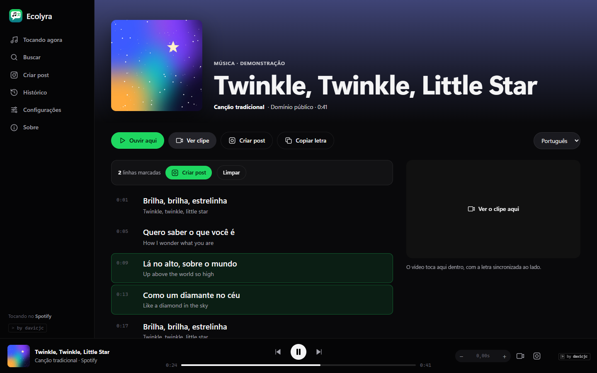
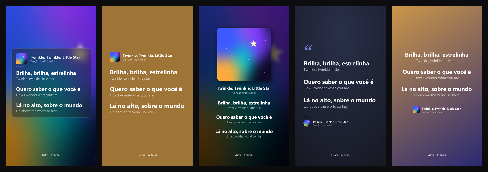
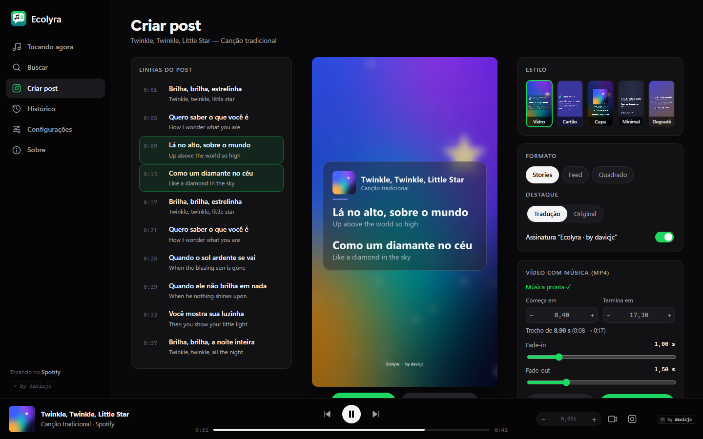
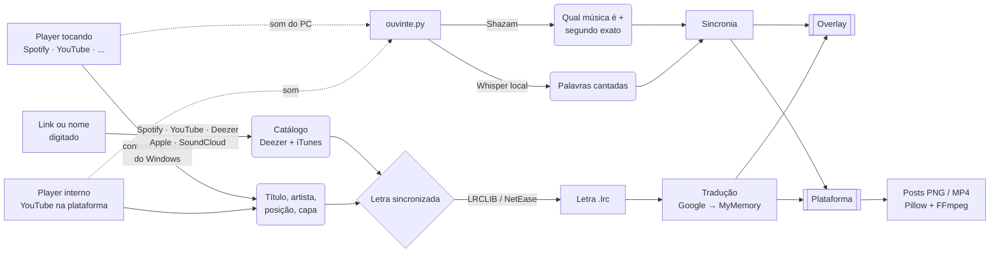

<p align="center">
  
</p>

<p align="center">
  <a href="https://github.com/Davicjc/ecolyra/releases/latest"></a>
  
  
  
  
</p>

<p align="center">
  <b>Ecolyra</b> mostra a letra da música que está tocando — <b>traduzida e sincronizada</b>, linha por linha —<br>
  por cima de qualquer janela <b>ou</b> numa plataforma própria, onde você <b>busca qualquer música por nome ou link</b>,<br>
  assiste o <b>clipe ali dentro</b> e cria <b>posts em imagem ou vídeo com a música de fundo</b>.<br>
  Funciona com <b>Spotify</b>, <b>YouTube</b>, YouTube Music, Deezer, VLC e qualquer player dos controles de mídia do Windows.
</p>

<p align="center"><sub>criado por <a href="https://davicjc.github.io/PortfolioPessoal"><b>davicjc</b></a></sub></p>

---

<p align="center">
  
</p>

## 🆕 Novidades da versão 2

| | |
|---|---|
| 🔎 **Busca por link ou nome** | Cole um link do **Spotify, YouTube, YouTube Music, Deezer, Apple Music ou SoundCloud** — ou só escreva o nome — e a música aparece com a letra traduzida. **Não precisa estar tocando.** |
| 🖥️ **Dois modos de exibição** | **Telas flutuantes** (o overlay de sempre, por cima de jogos e do navegador) ou **Aba única** — uma janela só, com cara de app de música, onde está tudo. |
| 🎬 **Vídeos dentro do app** | Assista o **clipe oficial** ou ouça a **versão de estúdio** sem sair do Ecolyra, com a letra sincronizada ao lado. Se um vídeo não deixa tocar fora do YouTube, ele tenta o próximo sozinho. |
| 🎨 **5 estilos de post** | Vidro fosco · Cartão colorido · Capa em destaque · Minimal · Degradê — em Stories, Feed ou Quadrado. |
| 🎞️ **Post em vídeo com a música** | Marque as linhas, escolha o trecho, ajuste **fade-in e fade-out** e exporte um **MP4** em que cada linha acende na hora em que é cantada. |
| 🧠 **Identificação melhor** | Catálogo do **Deezer + iTunes** para achar o nome “oficial” mesmo com título de vídeo bagunçado, preferindo o álbum original a coletâneas; letra simples quando não existe a sincronizada. |
| 🔄 **Atualização automática** | Saiu versão nova aqui no GitHub? O Ecolyra baixa, confere, instala e reinicia sozinho — **sem .exe, sem alarme do antivírus**. |
| ✍️ **Assinatura do criador** | O selo **by davicjc** aparece na plataforma, no overlay e (opcional) nos posts. |

## 🖥️ Dois jeitos de usar

| Telas flutuantes | Aba única (plataforma) |
|---|---|
|  |  |
| A letra fica **por cima de tudo** (jogo, navegador, trabalho). A busca abre numa janelinha compacta. | **Tudo numa janela**: tocando agora, busca, página da música com vídeo, estúdio de posts, histórico e configurações. |

Troque quando quiser: **Configurações → Modo de exibição**, no menu do botão direito do overlay ou no ícone da bandeja. Os dois funcionam juntos — a música que toca na plataforma aparece no overlay, e vice-versa.

## 🔎 Buscar qualquer música (link ou nome)

<p align="center">
  
</p>

- **Cole um link** e o Ecolyra já abre a música:
  `open.spotify.com/track/…` · `youtube.com/watch?v=…` · `youtu.be/…` · `music.youtube.com/…` · `deezer.com/track/…` · `music.apple.com/…?i=…` · `soundcloud.com/…`
- **Ou digite o nome** (“evidências chitãozinho”, “bohemian rhapsody”…) — os resultados vêm do Deezer e do iTunes ao mesmo tempo, sem repetição.
- Na página da música: **Ouvir aqui** (versão de estúdio, a letra bate certinho), **Ver clipe**, **Criar post**, **Copiar letra** e o idioma da tradução.
- Clique nas linhas para marcar o trecho do post (`Shift` + clique pega um intervalo); duplo clique no tempo pula o vídeo para aquela linha.
- No overlay: ícone 🔍 ou tecla **`P`**.

## 🎬 Vídeos dentro do Ecolyra

- **Ouvir aqui** toca a versão de estúdio (canal *Topic*/áudio oficial, com a duração mais próxima) — a letra sincroniza na hora.
- **Ver clipe** toca o clipe oficial. Como clipes têm introdução e cenas, o Ecolyra **escuta o áudio (Shazam)** e acerta o tempo da letra sozinho (testado: diferença de 0,2 s).
- O vídeo fica ao lado da letra, vira **mini player** quando você navega, e o botão 🎥 do player abre em **tela grande**.
- Quando a plataforma começa a tocar, o Spotify/YouTube de fora é **pausado** automaticamente; os botões do overlay passam a controlar o player interno.

## 📸 Posts: imagem e vídeo com a música de fundo

<p align="center">
  
</p>

<p align="center">
  
</p>

1. Marque as linhas (na página da música, no karaokê ou no overlay com `I`).
2. Escolha o **estilo**, o **formato** (Stories 1080×1920 · Feed 1080×1350 · Quadrado 1080×1080) e o **destaque** (tradução ou original).
3. **Salvar PNG** (vai para `Imagens\Ecolyra`) ou **Copiar imagem** e colar no WhatsApp/Instagram.
4. **Vídeo com música (MP4):**
   - o Ecolyra baixa a versão de estúdio da música (`yt-dlp`) — plano B: a prévia de 30 s do Deezer/iTunes;
   - o trecho começa e termina nas linhas marcadas — ajuste com `−`/`+` de 0,25 s;
   - **fade-in** e **fade-out** de 0 a 6 s (no som e na imagem);
   - **Ouvir trecho** antes de exportar;
   - **Exportar vídeo**: H.264 + AAC, cada linha acende quando é cantada, com transição suave. Vai para `Vídeos\Ecolyra`.

> As imagens deste README usam canções de domínio público e capas abstratas geradas, só para demonstração.

## 🔄 Atualização automática

O Ecolyra verifica as [releases do GitHub](https://github.com/Davicjc/ecolyra/releases) ao abrir e a cada 6 horas. Quando há versão nova:

1. baixa o `Ecolyra.zip` da release por HTTPS;
2. confere o **SHA-256** publicado pelo próprio GitHub;
3. confere se o código novo está íntegro (o `ecolyra.pyw` compila) antes de trocar qualquer coisa;
4. copia os arquivos por cima — **`config.json` e `cache/` nunca são tocados** — com troca atômica (nunca fica arquivo pela metade);
5. guarda a versão anterior em `.versoes/` (dá para voltar);
6. se as bibliotecas mudaram, roda o `pip` do próprio Python (janela oculta);
7. reinicia sozinho — mas **espera a música da plataforma terminar** em vez de cortá-la.

**Por que o antivírus não implica:** o Ecolyra não é um `.exe`. A atualização só baixa **código Python e imagens** (texto puro, que você pode abrir e ler), não executa nada de dentro do zip, não usa PowerShell codificado e não mexe em pasta do sistema. O app roda com o `pythonw.exe` oficial já instalado.

Desligar: **Configurações → Atualizar automaticamente**. Verificar na hora: **Configurações → Verificar agora**, menu do overlay ou bandeja.

## 📥 Como instalar

1. Baixe o **[Ecolyra.zip](https://github.com/Davicjc/ecolyra/releases/latest)**.
2. Extraia a pasta onde quiser (ex.: `Documentos\Ecolyra`).
3. Dê dois cliques em **`INSTALAR.bat`**.

O instalador encontra o Python (ou instala o **Python 3.12** pelo `winget`), instala as bibliotecas, cria o atalho **Ecolyra** na área de trabalho e já abre o app. Depois disso, as próximas versões chegam **sozinhas**.

> **Requisitos:** Windows 10 ou 11 · internet · ~1 GB livre · Microsoft Edge (já vem no Windows) para a plataforma.
> Quem tinha a v1: rode o `INSTALAR.bat` da v2 uma vez — a partir dela, a atualização é automática.

## 🎮 Atalhos

**Overlay** (com a janela em foco)

| Tecla | Ação |
|---|---|
| `Espaço` | tocar / pausar |
| `Ctrl` + `←` / `→` | música anterior / próxima |
| `+` / `-` | adiantar / atrasar a letra 0,25 s (`0` zera) |
| `Ctrl` + `+` / `-` | adiantar / atrasar 2 s |
| `P` | **pesquisar música (link ou nome)** |
| `O` | liga/desliga a frase original |
| `L` | letra completa |
| `I` | criar imagem para postar |
| `Esc` | esconder na bandeja |
| botão direito | menu com todas as opções (modo de exibição, atualizações, sobre…) |

**Plataforma**

| Tecla | Ação |
|---|---|
| `Ctrl` + `K` ou `/` | ir para a busca |
| `Espaço` | tocar / pausar |
| `Esc` | sair do vídeo em tela grande |

**Barra de ícones do overlay:** idioma · frase original · próxima linha · tamanho · largura · opacidade · sincronia pelo áudio · fonte da música · 🔍 pesquisar · ⧉ abrir a plataforma · 📷 imagem · copiar · buscar de novo · esconder controles · iniciar com o Windows · **by davicjc** (sobre).

## 🧠 Como funciona



- **Ecolyra (`ecolyra.pyw`)** lê o player do Windows, busca a letra, traduz, sincroniza e mostra o overlay.
- **Plataforma (`plataforma.py` + `web/`)** é um servidor local (só `localhost`, com token aleatório por sessão) e uma janela do Edge em modo app — sem barra de endereço, parece um programa.
- **`fontes.py`** identifica músicas e links, busca letras e vídeos; **`posts.py`** desenha os posts e monta o vídeo; **`atualizador.py`** cuida das atualizações; **`ouvinte.py`** escuta o som num processo separado.

## 🔒 Privacidade

- O app consulta APIs públicas de **letras** (LRCLIB, NetEase), **tradução** (Google Translate, MyMemory), **catálogo/capas** (Deezer, iTunes), **vídeos** (YouTube) e **atualizações** (GitHub).
- A **sincronia pelo áudio** envia ao Shazam uma **impressão digital** de ~7 s do som — não o áudio em si. O Whisper roda **localmente**. Desligar: ícone 🎙 → **Desligada**.
- O servidor da plataforma só aceita conexões do próprio PC e exige um token gerado a cada abertura.
- O Ecolyra **não distribui letras nem músicas**: tudo é buscado na hora e fica só no cache da sua máquina. O áudio baixado para o vídeo do post é para uso pessoal — respeite os direitos dos artistas ao publicar.

## 🗂️ O que tem na pasta

| Arquivo | Para que serve |
|---|---|
| `INSTALAR.bat` / `instalar.ps1` | instala tudo e cria o atalho |
| `Abrir Ecolyra.bat` | abre o app |
| `ecolyra.pyw` | overlay, leitura do player, sincronia, tradução, bandeja |
| `plataforma.py` + `web/` | a plataforma (servidor local + interface) |
| `fontes.py` | links, catálogo, letras, vídeos, áudio |
| `posts.py` | imagens (5 estilos) e vídeo com música |
| `atualizador.py` | atualização automática pelo GitHub |
| `versao.py` | número da versão e créditos |
| `ouvinte.py` | escuta o som do PC (Shazam + Whisper) |
| `docs/` | imagens do README (`gerar_imagens_docs.py` e `gerar_telas_plataforma.py` geram de novo) |

Criados no uso (ignorados pelo git): `config.json`, `cache/` (letras, traduções, capas, áudios, histórico) e `.versoes/` (backups das atualizações).

## ❓ Problemas comuns

<details>
<summary><b>O vídeo não toca dentro do Ecolyra</b></summary>

Alguns clipes (principalmente de gravadoras) não permitem tocar fora do YouTube. O Ecolyra tenta os próximos resultados sozinho; se nenhum tocar, use **Ouvir aqui** (versão de estúdio) ou **trocar vídeo**.
</details>

<details>
<summary><b>“Não consegui baixar a música” no vídeo do post</b></summary>

O YouTube muda de tempos em tempos e o `yt-dlp` precisa acompanhar. A atualização automática do Ecolyra roda o `pip` quando necessário; para forçar: `python -m pip install -U yt-dlp`. Enquanto isso, o app usa a prévia de 30 s do Deezer/iTunes.
</details>

<details>
<summary><b>A letra não aparece / “Sem letra sincronizada”</b></summary>

Nem toda música tem letra sincronizada nas bases abertas. Pela busca, o Ecolyra mostra a **letra simples** quando é o que existe (dá para fazer imagem; o vídeo precisa da sincronizada). Em vídeos, ele tenta reconhecer pelo áudio.
</details>

<details>
<summary><b>A letra está adiantada/atrasada</b></summary>

`+` / `-` (0,25 s) no overlay ou os botões `−`/`+` do player da plataforma — o ajuste fica salvo por música. Em vídeos a sincronia é automática; se precisar, ícone 🎙 → **Sincronizar de novo agora**.
</details>

<details>
<summary><b>Fica em “Escutando a música…” e não sai</b></summary>

O som precisa sair pela **saída de áudio padrão** do Windows (é ela que o app escuta). Trechos só instrumentais demoram mais. Ajustando com `+`/`-`, a letra aparece na hora.
</details>

<details>
<summary><b>“Tradução indisponível, tentando de novo…”</b></summary>

Os serviços gratuitos de tradução às vezes limitam o uso. O app troca de serviço sozinho e continua tentando; enquanto isso mostra a letra original.
</details>

<details>
<summary><b>Quero voltar para a versão anterior</b></summary>

Os arquivos substituídos ficam em `.versoes\<versão>\`. Copie-os de volta para a pasta do Ecolyra e desligue **Atualizar automaticamente** em Configurações.
</details>

## 🛠️ Para desenvolvedores: publicar uma versão

1. Suba o número em `versao.py` (ex.: `2.1.0`).
2. Commit e push.
3. Gere o zip e publique a release com a **tag igual à versão**:

```powershell
git archive --format=zip --prefix=Ecolyra/ -o release/Ecolyra.zip HEAD
gh release create v2.1.0 release/Ecolyra.zip --title "Ecolyra 2.1.0" --notes "o que mudou"
```

Pronto — todo mundo que usa o Ecolyra recebe a versão nova em até 6 horas (ou na hora, em **Verificar agora**). Uma pasta com `.git` (a sua, de desenvolvimento) só **avisa**; não sobrescreve código.

## 🙏 Créditos

[LRCLIB](https://lrclib.net) · NetEase Cloud Music · Deezer API · iTunes Search API · YouTube · Google Translate · [MyMemory](https://mymemory.translated.net) · [shazamio](https://github.com/shazamio/ShazamIO) · [faster-whisper](https://github.com/SYSTRAN/faster-whisper) · [yt-dlp](https://github.com/yt-dlp/yt-dlp) · [FFmpeg](https://ffmpeg.org) · [PyAudioWPatch](https://github.com/s0d3s/PyAudioWPatch) · [pycaw](https://github.com/AndreMiras/pycaw) · [pystray](https://github.com/moses-palmer/pystray) · Python/WinRT

Ecolyra é um projeto pessoal, sem vínculo com Spotify, YouTube, Deezer, Apple, Shazam ou Google.

## 👤 Criador

Feito por **[davicjc](https://davicjc.github.io/PortfolioPessoal)** — o selo `> by davicjc` no canto da plataforma é a assinatura oficial.

## 📄 Licença

[MIT](LICENSE) © 2026 Davi Castro
