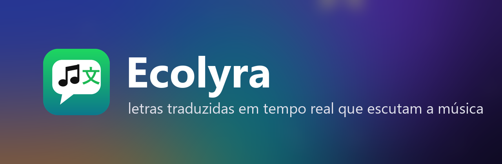
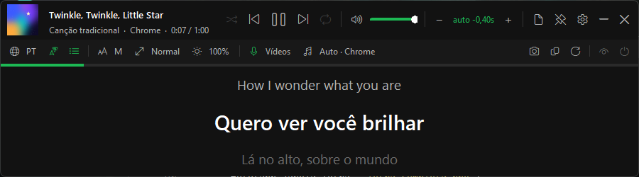
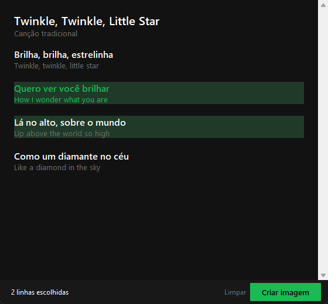
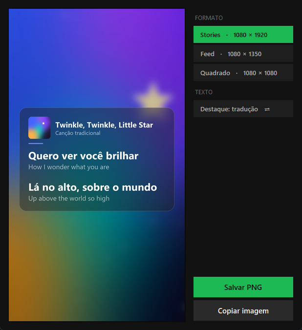
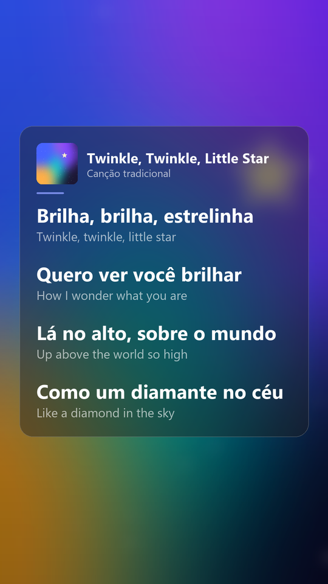
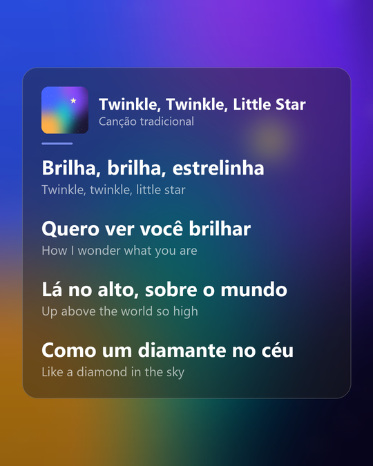
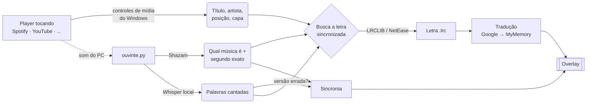

  

  
  
  
  

  <b>Ecolyra</b> mostra, por cima de qualquer janela, a letra da música que está tocando — <b>traduzida e sincronizada</b>, linha por linha. 
  Funciona com <b>Spotify</b>, <b>YouTube</b>, YouTube Music, Deezer, VLC e qualquer player que apareça nos controles de mídia do Windows. 
  Em clipes e vídeos, ele <b>escuta a música</b> para reconhecer qual é e acertar o tempo da letra sozinho.

---

  

## ✨ O que ele faz

| | |
|---|---|
| 🎵 **Letra em tempo real** | A linha que está sendo cantada, traduzida em destaque, com a original em cima e a próxima embaixo. |
| 🌐 **8 idiomas** | Português, English, Español, Français, Italiano, Deutsch, 日本語 e 한국어 — troca com um clique. |
| 🎧 **Escuta a música** | Em vídeos, usa a impressão digital do áudio (Shazam) para **descobrir a música** mesmo com título bagunçado e **achar o segundo exato** em que ela está. |
| ⏱️ **Sincronia automática** | Clipe com introdução, cena falada ou final diferente? Ele mede a diferença e corrige — e confere de novo de tempos em tempos. |
| 🧠 **Escolhe a versão certa** | Se a letra encontrada não bate com o que está sendo cantado (ex.: veio em inglês e o clipe é em japonês), ele compara as versões com o áudio e fica com a correta. |
| 📸 **Imagem para postar** | Escolha as linhas e gere um PNG lindo para **Stories, Feed ou Quadrado**, com a capa do álbum desfocada no fundo. |
| 🛟 **Não para de traduzir** | Três serviços de tradução em sequência; se um bloquear, passa pro próximo e tenta de novo sozinho. |
| 🎛️ **Controle do player** | Tocar/pausar, anterior/próxima, aleatório, repetir, volume e barra de progresso clicável. |
| 💾 **Lembra de tudo** | Letras, traduções, capas e a sincronia de cada vídeo ficam em cache — na segunda vez é instantâneo. |

## 📸 Imagem para postar

Abra a **Letra completa** (tecla `L`), clique nas linhas que quiser (`Shift` + clique pega um trecho) e aperte **Criar imagem** — ou aperte `I` para já começar pela linha que está tocando.

  
  &nbsp;
  

  
  &nbsp;&nbsp;
  

- **Stories** 1080 × 1920 (o texto fica longe das bordas que o Instagram cobre), **Feed** 1080 × 1350, **Quadrado** 1080 × 1080.
- Fundo com a capa do álbum em alta resolução, desfocada; cartão de vidro com a capa, o nome da música e o artista.
- **Salvar PNG** (vai para `Imagens\Ecolyra`) ou **Copiar imagem** e colar direto no WhatsApp/Instagram.

> As imagens acima usam uma capa abstrata e uma cantiga de domínio público só para demonstração.

## 📥 Como instalar

1. Baixe o **[Ecolyra.zip](https://github.com/Davicjc/ecolyra/releases/latest)** (ou, aqui em cima, **Code → Download ZIP**).
2. Extraia a pasta onde quiser (ex.: `Documentos\Ecolyra`).
3. Dê dois cliques em **`INSTALAR.bat`**.

Pronto. O instalador:

- encontra o Python (ou instala o **Python 3.12** pelo `winget` se você não tiver);
- instala as bibliotecas;
- cria o atalho **Ecolyra** na área de trabalho;
- e já abre o app.

Depois é só usar o atalho — ou o **`Abrir Ecolyra.bat`** da pasta.

> **Requisitos:** Windows 10 ou 11 · internet (para buscar letras e traduzir) · ~1 GB livre.
> Na primeira vez que precisar da transcrição de voz (só como reserva, em músicas que o Shazam não conhece), o modelo de IA de ~460 MB é baixado automaticamente.

## 🎮 Como usar

Abra o Ecolyra e toque uma música. A janelinha fica por cima de tudo; arraste para onde quiser. Os controles aparecem quando o mouse passa por cima e somem sozinhos.

**Barra de ícones** (logo abaixo do título):

| Ícone | Função |
|---|---|
| 🌐 `PT` | idioma da tradução |
| 文 | mostrar a frase original |
| ☰ | mostrar a próxima linha |
| `A M` · ↔ · ☀ | tamanho da letra, largura e opacidade |
| 🎙 `Vídeos` | sincronia pelo áudio: **só vídeos** (padrão), sempre, ou desligada |
| ♫ `Auto · Chrome` | de onde vem a música: automático (segue o que estiver tocando) ou um player fixo |
| 📷 · ⧉ · ⟳ | criar imagem, copiar a tradução, buscar a letra de novo |
| 👁 · ⏻ | esconder os controles sozinho · iniciar com o Windows |

**Atalhos de teclado** (com a janela em foco):

| Tecla | Ação |
|---|---|
| `Espaço` | tocar / pausar |
| `Ctrl` + `←` / `→` | música anterior / próxima |
| `+` / `-` | adiantar / atrasar a letra 0,25 s (`0` zera) |
| `Ctrl` + `+` / `-` | adiantar / atrasar 2 s |
| `O` | liga/desliga a frase original |
| `L` | letra completa |
| `I` | criar imagem para postar |
| `Esc` | esconder na bandeja |
| botão direito | menu com todas as opções |

## 🧠 Como funciona

1. **O que está tocando:** o Ecolyra lê título, artista, posição e capa pelos *controles de mídia do Windows* (os mesmos do painel de volume). Por isso funciona com qualquer player que apareça ali.
2. **A letra:** busca a letra **sincronizada** (formato LRC) no [LRCLIB](https://lrclib.net) e, se não achar, no NetEase. Títulos de vídeo como `Artista - Música (Official Video) [4K]` ou `CG5 × Pomni - Música [...]` são limpos e testados de vários jeitos.
3. **A tradução:** traduz só as linhas únicas (o refrão vai uma vez) e guarda em cache.
4. **No Spotify** o tempo já bate com a letra — nada é escutado.
5. **Em vídeos**, o processo `ouvinte.py` grava alguns segundos do som do PC e:
   - manda uma **impressão digital** do áudio pro Shazam → descobre a música e em que segundo da gravação de estúdio aquele trecho está → diferença de tempo exata;
   - se precisar, transcreve com o **Whisper** (rodando no seu PC) e procura as palavras cantadas na letra.
   - A letra só começa a andar depois que a sincronia é **confirmada** (duas medições que concordam). Até lá aparece *“Escutando a música para sincronizar a letra…”*.

## 🔒 Privacidade

- Nada sai do seu PC sem motivo: o app consulta APIs públicas de **letras** (LRCLIB, NetEase), **tradução** (Google Translate, MyMemory) e **capas** (iTunes).
- A **sincronia pelo áudio** (só em vídeos/players que não são o Spotify) envia ao Shazam uma **impressão digital** de ~7 s do som — não o áudio em si. A transcrição pelo Whisper roda **localmente**.
- Não quer? Ícone 🎙 → **Desligada**.
- O Ecolyra **não distribui letras**: elas são buscadas na hora e ficam só no cache da sua máquina.

## 🗂️ O que tem na pasta

| Arquivo | Para que serve |
|---|---|
| `INSTALAR.bat` | instala tudo e cria o atalho |
| `Abrir Ecolyra.bat` | abre o app |
| `ecolyra.pyw` | o app (interface, letras, tradução, sincronia, imagens) |
| `ouvinte.py` | escuta o som do PC (Shazam + Whisper) num processo separado |
| `icone.ico` / `icone.png` | ícone (gerado por `gerar_icone.py`) |
| `requirements.txt` | bibliotecas Python |
| `docs/` | imagens deste README (`gerar_imagens_docs.py` gera de novo) |

Criados no uso (e ignorados pelo git): `config.json` (suas preferências) e `cache/` (letras, traduções, capas e sincronias).

## ❓ Problemas comuns

<b>A letra não aparece / “Sem letra sincronizada”</b>

Nem toda música tem letra sincronizada nas bases abertas. Em vídeos, o Ecolyra tenta reconhecer pelo áudio; se nem assim achar, a música provavelmente não tem letra sincronizada publicada. Tente **Buscar a letra de novo** (⟳) depois de um tempo.

<b>A letra está adiantada/atrasada</b>

No Spotify, use `+` / `-` (0,25 s) — o ajuste fica salvo por música. Em vídeos, a sincronia é automática; se precisar, `Ctrl` + `+` / `-` move 2 s, ou ícone 🎙 → **Sincronizar de novo agora**.

<b>Fica em “Escutando a música…” e não sai</b>

O som precisa estar saindo pela **saída de áudio padrão** do Windows (é ela que o app escuta). Trechos só instrumentais ou com muito barulho por cima demoram mais. Se você ajustar com `+`/`-`, a letra aparece na hora.

<b>“Tradução indisponível, tentando de novo…”</b>

Os serviços gratuitos de tradução às vezes limitam o uso. O app troca de serviço sozinho e continua tentando; enquanto isso mostra a letra original.

<b>O instalador falhou</b>

Instale o Python manualmente em [python.org](https://www.python.org/downloads/) marcando **“Add python.exe to PATH”** e rode o `INSTALAR.bat` de novo.

## 🙏 Créditos

[LRCLIB](https://lrclib.net) · NetEase Cloud Music · Google Translate · [MyMemory](https://mymemory.translated.net) · iTunes Search API · [shazamio](https://github.com/shazamio/ShazamIO) · [faster-whisper](https://github.com/SYSTRAN/faster-whisper) · [PyAudioWPatch](https://github.com/s0d3s/PyAudioWPatch) · [pycaw](https://github.com/AndreMiras/pycaw) · [pystray](https://github.com/moses-palmer/pystray) · Python/WinRT

Ecolyra é um projeto pessoal, sem vínculo com Spotify, YouTube, Shazam ou Google. Use as APIs de terceiros com bom senso.

## 📄 Licença

[MIT](LICENSE) © 2026 Davi Castro
